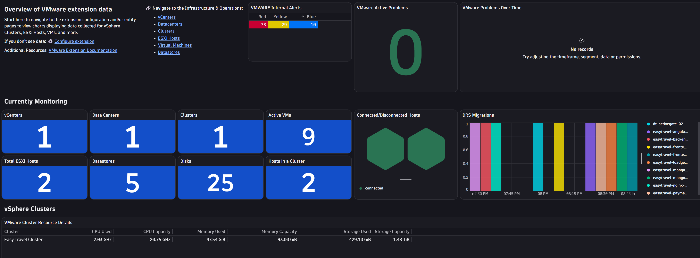
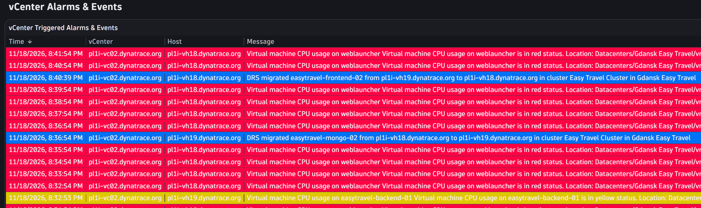
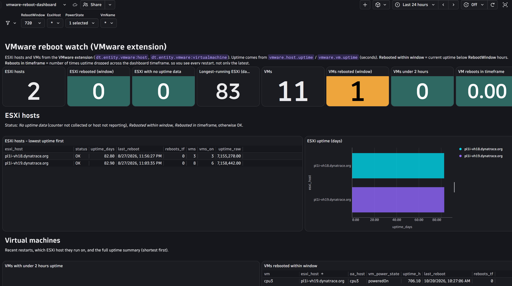
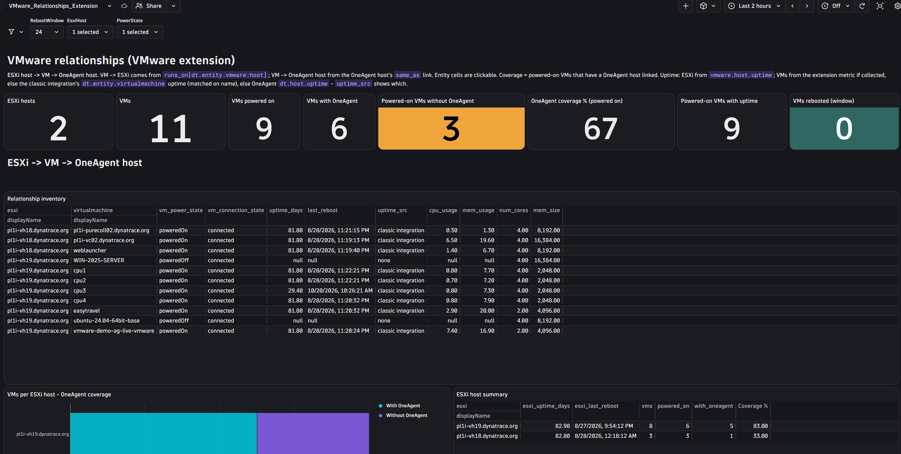
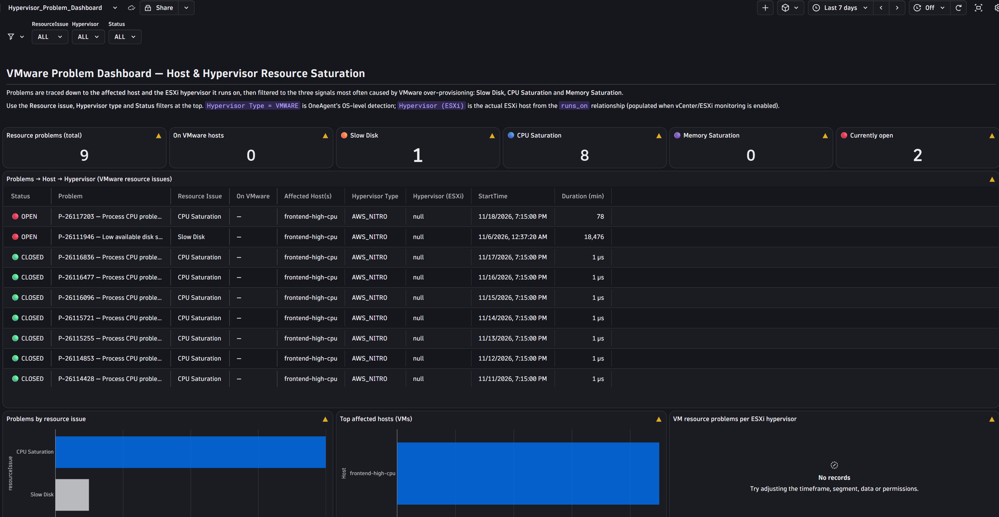

# VMware Dashboards for Dynatrace

A collection of VMware-focused dashboards for Dynatrace. They put vCenter, ESXi hosts, clusters, datastores and VMs next to the services that run on them, so when an application hurts you can tell whether the cause is the code, the platform, or the platform's own decisions (DRS, overcommitment, storage latency).

> Is your infra getting the same attention as your apps?

Built with Greg O'Reilly and the Visibility Platforms team.

## Why

APM can point you at the wrong place. An overcommitted ESXi host, VMs queued in CPU ready, a slow datastore or ballooned memory all look fine from inside the guest. DRS migrations show up as latency spikes (vMotion stun), and if the VM is undersized or storage is the bottleneck, the saturation follows the VM to its new host.

With vCenter events and health status (green/yellow/red) ingested next to the metrics, one screen shows the sequence: alarm raised, DRS migration, response time spike.

## Dashboards

| Dashboard | File | What it shows |
|---|---|---|
| **VMware - Overview with Alerts** | [VMware - Overview with Alerts.json](VMware%20-%20Overview%20with%20Alerts.json) | Start here. vCenters, datacenters, clusters, hosts, VMs and datastores with CPU/memory usage, plus vCenter triggered alarms and events (including DRS migrations). |
| **VMware reboot watch** | [vmware-reboot-dashboard.json](vmware-reboot-dashboard.json) | ESXi and VM uptime: recent reboots, VMs under 2 hours uptime, reboots by ESXi host, uptime sawtooth and last-reboot-by-day. Filters: reboot window, ESXi host, power state, VM name. |
| **VMware relationships** | [VMware_Relationships_Extension.json](VMware_Relationships_Extension.json) | ESXi host → VM → OneAgent host mapping. Shows OneAgent coverage per ESXi host and lists powered-on VMs without OneAgent. |
| **Hypervisor problem insights** | [Hypervisor_Problem_Dashboard.json](Hypervisor_Problem_Dashboard.json) | Davis problems traced to the affected host and its ESXi hypervisor, bucketed into Slow Disk, CPU Saturation and Memory Saturation. Filters: resource issue, hypervisor, status. |

### Screenshots

**Overview with Alerts**

**vCenter alarms and DRS events**: alarm raised, then DRS migration, on one timeline.

**Reboot watch**

**Relationships**

**Hypervisor problem insights**

## Prerequisites

All four dashboards rely on data from the **Dynatrace VMware extension** (extension ID `com.dynatrace.vmware-integration`). Install and configure it first, otherwise the tiles will be empty.

- **Extension on Dynatrace Hub:** [VMware (remote monitoring)](https://www.dynatrace.com/hub/detail/vmware-remote-monitoring/)
- **Documentation:** [VMware remote monitoring extension](https://docs.dynatrace.com/docs/observe/infrastructure-observability/extensions/vmware-remote-monitoring)

### What you need

- A Dynatrace environment with the Extensions Manager
- An **ActiveGate** with the EEC performance profile set to *High* or *Dedicated*, with network access to vCenter
- A **read-only vSphere user**. Administrator access isn't required.
- ESXi hosts managed by a vCenter don't need to be added individually.

### Extra requirements for specific dashboards

- **Relationships and Hypervisor Problem dashboards** use OneAgent data (`dt.entity.host`, `hypervisorType`, the `runs_on` relationship to the ESXi host) as well as the extension. Install OneAgent on the guest VMs you want mapped.
- **Reboot watch** needs the uptime counters (`vmware.vm.uptime` / `vmware.host.uptime`). Powered-off and suspended VMs have no uptime by design. ESXi hosts that don't report uptime show as *No uptime data*.

### Cost

The extension itself is free, but you pay for the data it ingests, including custom metrics and logs from vSphere events.

## Importing a dashboard

1. In Dynatrace, open **Dashboards**.
2. Select **Upload** and choose a `.json` file from this repo.
3. Open the dashboard and set the timeframe and filters.

If a tile is empty, check the extension configuration. The Overview dashboard links straight to it.

## Notes

- Dashboards use Grail/DQL against the extension's `dt.entity.vmware.*` entities and `vmware.*` metrics.
- The Overview dashboard contains links to the Infrastructure & Operations app and the extension config. These are relative to your own tenant.
- The Hypervisor problem buckets are keyword-matched on the Davis problem title (`disk`, `cpu`, `memory`). Edit the keywords in the tile queries to suit your environment.

